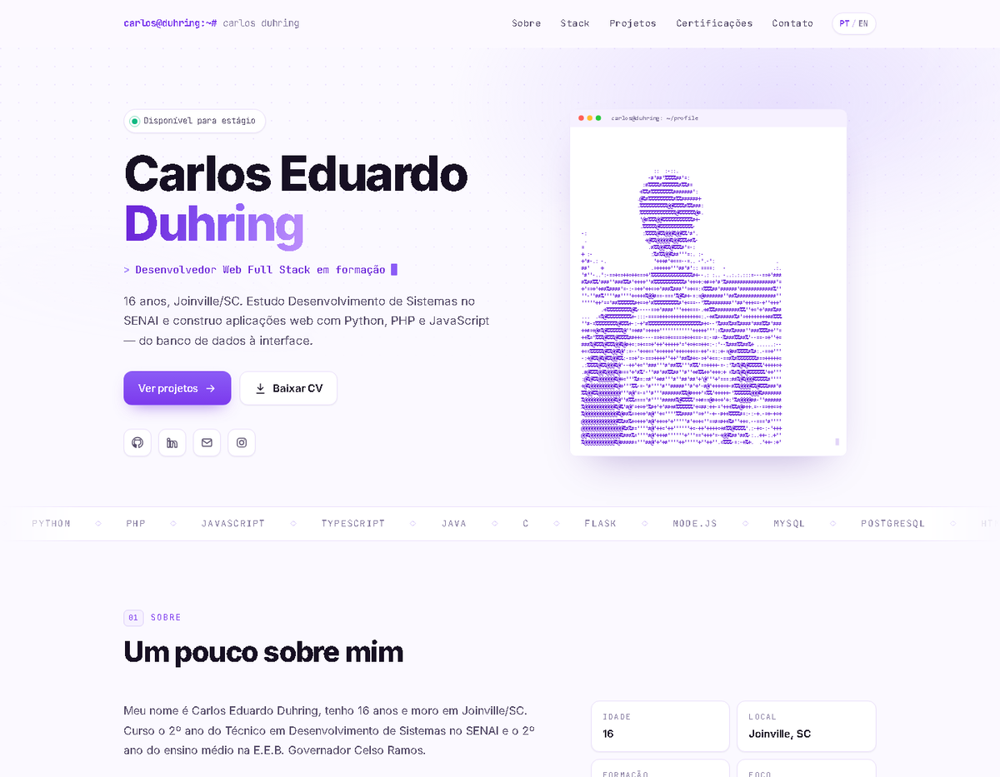

# Portfólio — Carlos Duhring

Site pessoal com projetos, stack, certificados e contato. Tema claro em lavanda/violeta,
**bilíngue (PT/EN)**, totalmente responsivo e feito **sem frameworks nem build step**.



## Sobre

Página única com cinco seções numeradas: sobre, stack, projetos, certificações e contato.
O conteúdo é estático — basta um navegador para abrir.

## Stack

- **HTML5** semântico (landmarks, `aria-*`, link de pular conteúdo)
- **CSS3** — custom properties, CSS Grid, `clamp()`, gradientes e animações
- **JavaScript** puro — sem jQuery, sem React, sem dependências de build

## Recursos

- **PT/EN** — troca de idioma instantânea com dicionário de chaves `data-i18n` e preferência salva em `localStorage`
- **Efeito de digitação** no hero, com respeito a `prefers-reduced-motion`
- **Reveal no scroll** via `IntersectionObserver` (com escalonamento entre irmãos)
- **Navegação ativa** acompanhando a seção visível e barra de progresso de leitura
- **Menu mobile** acessível (`aria-expanded`, fecha com `Esc` e ao clicar em um link)
- **Copiar e-mail** com `navigator.clipboard` e fallback para navegadores antigos
- Fontes com fallback de sistema; o site funciona offline

## Estrutura

```
.
├── index.html
├── assets
│   ├── css/style.css
│   ├── js
│   │   ├── i18n.js      # dicionário PT/EN
│   │   └── main.js      # idioma, digitação, reveal, menu, copiar
│   ├── img
│   │   ├── ascii-avatar.svg
│   │   └── favicon.svg
│   └── Curriculo-Carlos-Duhring.pdf
└── preview.png
```

## Rodar localmente

```bash
git clone https://github.com/CarlosDuhring/Portfolio.git
cd Portfolio
# abra o index.html no navegador ou sirva a pasta:
python -m http.server 5500
```

Depois acesse `http://localhost:5500`.

## Adicionar um projeto

1. Copie um bloco `<article class="card">` no `index.html`.
2. Ajuste título, link do repositório, tags e a chave `data-i18n` da descrição.
3. Adicione a mesma chave nos dois idiomas em `assets/js/i18n.js`.

## Contato

- E-mail: carlosduhring@gmail.com
- LinkedIn: [carlos-eduardo-duhring](https://www.linkedin.com/in/carlos-eduardo-duhring-6449923a4/)
- GitHub: [@CarlosDuhring](https://github.com/CarlosDuhring)
